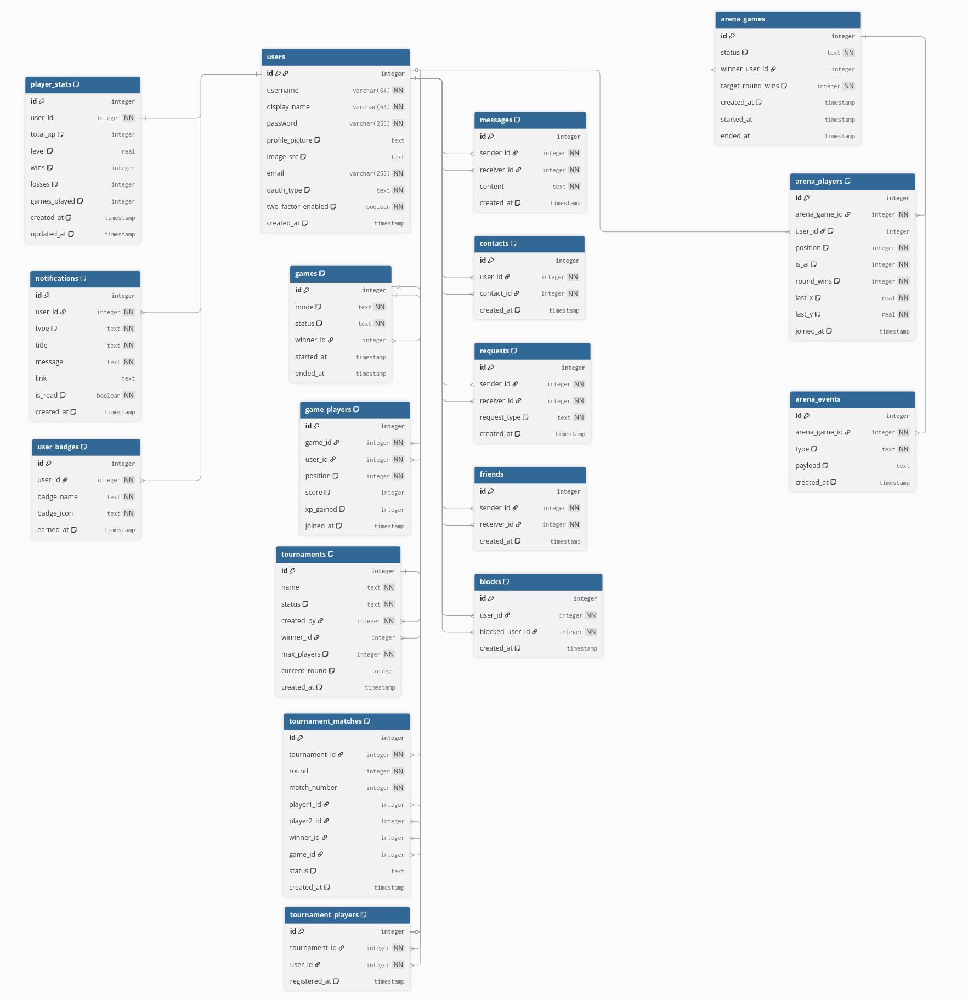

*This project has been created as part of the 42 curriculum by hibenouk, mregrag, zel-oirg, ael-garr*
# 🏓 ft_transcendence - PingPong Arena

A modern, full-stack real-time multiplayer Pong game platform with chat, tournaments, and comprehensive monitoring.


---

## 📋 Table of Contents

- [Description](#-description)
- [Team Information](#-team-information)
- [Technical Stack](#-technical-stack)
- [Database Schema](#-database-schema)
- [Features List](#-features-list)
- [Modules](#-modules)
- [Individual Contributions](#-individual-contributions)
- [Instructions](#-instructions)
- [Resources](#-resources)

---

## 📖 Description

**PingPong Arena** is a web-based multiplayer Pong game platform developed as part of the 42 School ft_transcendence project. The application allows users to play the classic Pong game in various modes, chat with other players in real-time, participate in tournaments, and track their progress on leaderboards.

### Key Features

- 🎮 **Multiple Game Modes**: Remote multiplayer, local 1v1, tournaments, and Arena mode
- 💬 **Real-time Chat**: WebSocket-based instant messaging with friend system
- 🔐 **Secure Authentication**: Local auth, OAuth2 (42 Intra, Google), and Two-Factor Authentication
- 🏆 **Tournaments**: Automated bracket system with registration and live matches
- 📊 **Player Statistics**: XP system, levels, leaderboards, and match history
- 🔔 **Real-time Notifications**: Live updates for game invites, friend requests, and messages
- 📈 **Monitoring Stack**: Prometheus metrics with Grafana dashboards
- 📝 **Centralized Logging**: ELK Stack (Elasticsearch, Logstash, Kibana)

---

## 👥 Team Information

| Member | 42 Login | Role | Communication |
|--------|----------|------|---------------|
| **Hicham** | hibenouk | Team lead | Discord, Physical meetings |
| **Mohamed** | mregrag | Product Owner | Discord, Physical meetings |
| **Zakaria** | zel-oirg | Product Manager | Discord, Physical meetings |
| **Ayoub** | ael-garr | Devloper | Discord, Physical meetings |

### Communication Channels
- **Discord**: Primary communication for daily standups and quick discussions
- **Physical Meetings**: Regular in-person meetings for planning, code reviews, and pair programming sessions

---

## 🛠 Technical Stack

### Frontend
| Technology | Version | Purpose |
|------------|---------|---------|
| **React** | 19.1.0 | UI Framework |
| **TypeScript** | 5.8.3 | Type-safe JavaScript |
| **Vite** | 6.4.1 | Build tool & dev server |
| **TailwindCSS** | 4.1.16 | Utility-first CSS |
| **TanStack Query** | 5.76.1 | Server state management |
| **Zustand** | 5.0.5 | Client state management |
| **React Router** | 7.6.0 | Client-side routing |
| **Axios** | 1.13.1 | HTTP client |
| **Zod** | 3.24.4 | Schema validation |

### Backend
| Technology | Version | Purpose |
|------------|---------|---------|
| **Fastify** | 5.3.3 | Web framework |
| **TypeScript** | 5.8.3 | Type-safe JavaScript |
| **SQLite3** | 5.1.7 | Database |
| **@fastify/jwt** | 9.1.0 | JWT authentication |
| **@fastify/websocket** | 11.0.2 | WebSocket support |
| **@fastify/oauth2** | 8.1.2 | OAuth2 integration |
| **Zod** | 3.25.74 | Request validation |
| **bcrypt** | 6.0.0 | Password hashing |
| **prom-client** | - | Prometheus metrics |

### Infrastructure
| Technology | Purpose |
|------------|---------|
| **Docker & Docker Compose** | Containerization |
| **Nginx** | Reverse proxy, SSL termination |
| **Prometheus** | Metrics collection |
| **Grafana** | Metrics visualization |
| **Elasticsearch** | Log storage & search |
| **Logstash** | Log processing |
| **Kibana** | Log visualization |

### Why SQLite?
SQLite was chosen for its:
- **Simplicity**: No separate database server required
- **Portability**: Single file database, easy to backup and deploy
- **Performance**: Excellent for read-heavy workloads and moderate write loads
- **Zero Configuration**: Works out of the box with minimal setup

### Major Technical Decisions
1. **Fastify over Express**: Better performance, built-in TypeScript support, and schema validation
2. **Zustand over Redux**: Simpler API, smaller bundle size, and sufficient for our state management needs
3. **TanStack Query**: Automatic caching, background refetching, and optimistic updates for better UX
4. **WebSockets**: Real-time communication for chat, game state, and notifications

---

## 🗄 Database Schema

### Visual Representation


### Tables Summary

| Table | Description | Key Fields |
|-------|-------------|------------|
| `users` | User accounts | username, email, password, oauth_type, two_factor_enabled |
| `messages` | Chat messages | sender_id, receiver_id, content |
| `contacts` | User contact list | user_id, contact_id |
| `requests` | Friend/chat requests | sender_id, receiver_id, request_type |
| `friends` | Friend relationships | sender_id, receiver_id |
| `blocks` | Blocked users | user_id, blocked_user_id |
| `games` | Pong game sessions | mode, status, winner_id |
| `game_players` | Players in games | game_id, user_id, score, xp_gained |
| `tournaments` | Tournament metadata | name, status, max_players, current_round |
| `tournament_players` | Tournament participants | tournament_id, user_id |
| `tournament_matches` | Tournament bracket | round, match_number, player1/2_id, winner_id |
| `player_stats` | Player statistics | total_xp, level, wins, losses |
| `user_badges` | Achievements | badge_name, badge_icon |
| `notifications` | User notifications | type, title, message, is_read |
| `arena_games` | Arena mode games | status, target_round_wins |
| `arena_players` | Arena participants | position, is_ai, round_wins |
| `arena_events` | Arena event log | type, payload |

---

## ✨ Features List

| Feature | Description | Implemented By |
|---------|-------------|----------------|
| **User Registration** | Create account with email verification | Hicham |
| **Local Authentication** | Login with username/email + password | Hicham |
| **OAuth2 (42 Intra)** | Login with 42 School account | Hicham |
| **OAuth2 (Google)** | Login with Google account | Hicham |
| **Two-Factor Auth (2FA)** | Email-based OTP verification | Hicham |
| **Password Reset** | Email-based password recovery | Hicham |
| **User Profiles** | View/edit profile, avatar upload | Hicham |
| **Real-time Chat** | WebSocket instant messaging | Hicham, Ayoub |
| **Friend System** | Send/accept friend requests | Hicham |
| **Block Users** | Block/unblock functionality | Hicham |
| **Contact List** | Manage chat contacts | Hicham |
| **Remote Pong Game** | Real-time multiplayer pong | Mohamed |
| **Local Pong Game** | Same-device 2-player game | Mohamed |
| **Game Engine** | Canvas-based pong physics | Mohamed |
| **Tournaments** | Bracket-based competitions | Mohamed |
| **Tournament Registration** | Join/leave tournaments | Mohamed |
| **Match History** | View past games | Mohamed |
| **Leaderboard** | Global player rankings | Mohamed |
| **XP & Leveling** | Experience points system | Mohamed |
| **Player Statistics** | Wins, losses, win rate | Mohamed |
| **Arena Mode** | Alternative game mode | Zakaria |
| **Arena Matchmaking** | Queue-based player matching | Zakaria |
| **Arena AI Opponent** | Play against computer | Zakaria |
| **Arena Statistics** | Arena-specific stats | Zakaria |
| **Arena Spectating** | Watch live arena games | Zakaria |
| **Arena Public Api** | A public API to interact with the database with a secured	 | Zakaria |
| **Prometheus Metrics** | Application monitoring | Ayoub |
| **Grafana Dashboards** | Metrics visualization | Ayoub |
| **ELK Stack Logging** | Centralized log management | Mohamed |
| **Real-time Notifications** | Live notification system | Mohamed, Hicham |
| **Online Status** | Show user online/offline | Hicham |

---

## 📦 Modules

### Module Summary
Minor: Real-time collaborative features (shared workspaces, live editing, collabo-
rative drawing, etc.)

| Category | Module | Type | Points |
|----------|--------|------|--------|
| Web | Backend Framework (Fastify) | Minor | 1 |
| Web | Frontend Framework (React) | Minor | 1 |
| Web | Implement real-time features using WebSockets  | Major | 2 |
| Web | Support for additional browsers. | Minor | 1 |
| Web | A public API to interact with the database with a secured | Major | 2|
| User Management | Remote Authentication (OAuth2) | Minor | 1 |
| User Management | Standard User Management | Major | 2 |
| User Management| Implement a complete 2FA | Minor | 1 | 
| Gameplay | Game statistics and match history | Minor | 1 |
| Gameplay | Introduce an AI Opponent for games | Major | 2 |
| Gameplay |Implement a complete web-based game where users can play | Major | 2 |
| Gameplay | Remote Players | Major | 2 |
| Gameplay | Another Game (Arena) | Major | 2 |
| Gameplay | Multiple Players (Tournaments) | Minor | 1 |
| Gameplay | A gamification system to reward users for their actions. | Minor | 1 |
| Gameplay | Implement spectator mode for games | Minor | 1 |
| DevOps | Monitoring (Prometheus/Grafana) | Major  | 2 |
| Custom | JWT Secure Token Management (Access & Refresh Tokens) | Major | 2 |
| **Total** | | | **27 pts** |


### Module Details

#### 1. Backend Framework - Fastify (Minor - 1pt)
**Justification**: Fastify provides excellent TypeScript support, built-in schema validation with Zod, and superior performance compared to Express.

**Implementation**:
- RESTful API with `/api` prefix
- JWT authentication middleware
- Request/response validation with Zod schemas
- Plugin-based architecture

**Worked on by**: All team members

---

#### 2. Frontend Framework - React (Minor - 1pt)
**Justification**: React 19 with modern hooks, combined with Vite for fast development and TailwindCSS for styling.

**Implementation**:
- Single Page Application with React Router
- Component-based architecture
- TanStack Query for server state
- Zustand for client state
- Responsive design with TailwindCSS

**Worked on by**: All team members

---

#### 3. Real-time Features with WebSockets (Major - 2pts)
**Justification**: WebSockets enable instant bidirectional communication for chat, game state, and notifications.

**Implementation**:
- Real-time chat messaging
- Live game state synchronization
- Instant notifications delivery
- Online/offline status tracking
- WebSocket connection management

**Worked on by**: Hicham, Mohamed

---

#### 4. Support for Additional Browsers (Minor - 1pt)
**Justification**: Cross-browser compatibility ensures all users can access the platform.

**Implementation**:
- Tested on Chrome, Firefox, Safari, and Edge
- Polyfills for older browser features
- Responsive design for various screen sizes
- CSS vendor prefixes where needed

**Worked on by**: All team members

---

#### 5. Public API with Database Security (Major - 2pts)
**Justification**: Secure RESTful API for external integrations with proper authentication and authorization.

**Implementation**:
- Public REST endpoints under /api/public
- API key authentication via X-API-Key header (required for all public routes)
- Role-based authorization for sensitive actions (admin-only endpoints for write operations)
- Input/output validation using Zod schemas (query params, route params, request bodies, and response shapes)
- Rate limiting per API key (fallback to IP) with proper HTTP 429 responses
- Database access through repository layer using parameterized queries (prevents SQL injection)

**Worked on by**: zakaria

---

#### 6. Remote Authentication - OAuth2 (Minor - 1pt)
**Justification**: Secure third-party authentication with 42 Intra and Google.

**Implementation**:
- 42 Intra OAuth2 integration
- Google OAuth2 integration
- Automatic account creation/linking
- Session management with JWT cookies

**Worked on by**: Hicham

---

#### 7. Standard User Management (Major - 2pts)
**Justification**: Comprehensive user system with profiles, avatars, friends, and blocking.

**Implementation**:
- User registration with email verification
- Profile customization (avatar, display name)
- Friend request system
- User blocking functionality
- Match history per user
- Statistics dashboard

**Worked on by**: Hicham

---

#### 8. Two-Factor Authentication (Minor - 1pt)
**Justification**: Enhanced account security with email-based OTP verification.

**Implementation**:
- Email-based OTP for 2FA
- Enable/disable 2FA in settings
- Secure verification flow
- Time-limited OTP codes

**Worked on by**: Hicham

---

#### 9. Game Statistics and Match History (Minor - 1pt)
**Justification**: Track player performance and game history for competitive gameplay.

**Implementation**:
- Match history per user
- Win/loss statistics
- XP and level progression
- Personal performance dashboard

**Worked on by**: Mohamed

---

#### 10. AI Opponent for Games (Major - 2pts)
**Justification**: Allows single players to practice and play against computer-controlled opponents.

**Implementation**:
- AI paddle movement algorithms
- Difficulty scaling
- Realistic ball prediction
- Integration with Arena mode

**Worked on by**: Zakaria

---

#### 11. Web-based Pong Game (Major - 2pts)
**Justification**: Core gameplay implementation with canvas-based rendering and physics.

**Implementation**:
- Canvas-based game rendering
- Ball physics and collision detection
- Paddle controls (keyboard/touch)
- Score tracking and game completion
- Local 2-player mode

**Worked on by**: Mohamed

---

#### 12. Remote Players (Major - 2pts)
**Justification**: Core multiplayer functionality with real-time game synchronization.

**Implementation**:
- WebSocket-based game rooms
- Real-time paddle and ball synchronization
- Score tracking and game completion
- Matchmaking system

**Worked on by**: Mohamed

---

#### 13. Another Game - Arena Mode (Major - 2pts)
**Justification**: Alternative game mode with different mechanics and separate statistics.

**Implementation**:
- Round-based gameplay (first to X wins)
- Dedicated matchmaking queue
- Separate leaderboard and statistics
- Arena-specific game mechanics

**Worked on by**: Zakaria

---

#### 14. Multiple Players - Tournaments (Minor - 1pt)
**Justification**: Competitive tournament system with bracket management.

**Implementation**:
- Tournament creation with configurable player limits (4, 8, 16)
- Registration system with deadline
- Automatic bracket generation
- Round progression
- Champion tracking

**Worked on by**: Mohamed

---

#### 15. Gamification System (Minor - 1pt)
**Justification**: Reward users for their actions to increase engagement.

**Implementation**:
- XP and leveling system
- Achievements and badges
- Leaderboard rankings
- Progress tracking

**Worked on by**: Mohamed

---

#### 16. Spectator Mode for Games (Minor - 1pt)
**Justification**: Allow users to watch live games without participating.

**Implementation**:
- Real-time game streaming to spectators
- Spectator-only WebSocket connections
- No interference with active gameplay
- Live score updates

**Worked on by**: Zakaria

---

#### 17. Monitoring - Prometheus & Grafana (Major - 2pts)
**Justification**: Application performance monitoring and alerting.

**Implementation**:
- Prometheus metrics endpoint (`/metrics`)
- Node exporter for system metrics
- Grafana dashboards
- Custom application metrics
- Alerting configuration

**Worked on by**: Ayoub

---

#### 18. JWT Secure Token Management - Custom Module (Major - 2pts)

**Why We Chose This Module**:
Authentication security is critical for any web application handling user data and real-time gaming sessions. Rather than using basic session-based authentication or storing tokens in localStorage (which is vulnerable to XSS attacks), we implemented a robust JWT-based authentication system with dual-token architecture that addresses modern web security challenges.

**Technical Challenges Addressed**:

1. **XSS (Cross-Site Scripting) Prevention**:
   - Tokens stored in `HttpOnly` cookies are inaccessible to JavaScript, preventing malicious scripts from stealing authentication credentials
   - Even if an attacker injects JavaScript into the page, they cannot read or exfiltrate the tokens

2. **CSRF (Cross-Site Request Forgery) Prevention**:
   - Cookies configured with `SameSite=Strict` attribute prevent browsers from sending cookies with cross-origin requests
   - Combined with `Secure` flag to ensure cookies are only transmitted over HTTPS

3. **Token Expiration & Rotation**:
   - Short-lived access tokens (15 minutes) limit the window of opportunity if a token is compromised
   - Long-lived refresh tokens (7 days) stored securely allow seamless token renewal without re-authentication
   - Automatic token refresh mechanism maintains user sessions without interruption

4. **Secure Cookie Configuration**:
   - `HttpOnly`: Prevents JavaScript access to cookies
   - `Secure`: Ensures cookies only sent over HTTPS
   - `SameSite=Strict`: Blocks cross-origin cookie transmission
   - `Path=/`: Scopes cookies appropriately

**How It Adds Value**:
- **User Trust**: Users can confidently use the platform knowing their sessions are protected against common web attacks
- **Seamless Experience**: Automatic token refresh provides uninterrupted gaming and chat sessions
- **Compliance Ready**: Follows security best practices recommended by OWASP for token-based authentication
- **Scalable Architecture**: Stateless JWT tokens allow horizontal scaling without shared session storage

**Why It Deserves Major Module Status (2 points)**:
1. **Technical Complexity**: Implementing dual-token architecture with automatic refresh, secure cookie handling, and proper expiration management requires deep understanding of web security, HTTP protocols, and browser behavior
2. **Security Critical**: Authentication is the gateway to all protected resources; a flaw here compromises the entire application
3. **Integration Depth**: The system integrates with OAuth2 providers, 2FA, WebSocket authentication, and all protected API endpoints
4. **Production-Grade Implementation**: Includes edge cases like token revocation, concurrent session handling, and graceful degradation

**Implementation**:
- Access tokens (JWT) with 15-minute expiration for API authorization
- Refresh tokens with 7-day expiration for session continuity
- Tokens stored in `HttpOnly`, `Secure`, `SameSite=Strict` cookies
- Automatic silent refresh before access token expiration
- Token refresh endpoint with refresh token rotation
- Secure logout with cookie invalidation
- Integration with @fastify/jwt for token signing and verification
- bcrypt password hashing with configurable salt rounds

**Worked on by**: Hicham

---

## 👤 Individual Contributions

### Hicham
**Focus**: Authentication & Chat System

**Contributions**:
- ✅ User registration with email confirmation
- ✅ Local authentication (login/logout)
- ✅ OAuth2 integration (42 Intra & Google)
- ✅ Two-Factor Authentication (2FA)
- ✅ Password reset functionality
- ✅ JWT token management
- ✅ Real-time chat with WebSockets
- ✅ Friend request system
- ✅ User blocking functionality
- ✅ Contact list management
- ✅ User profile settings
- ✅ Online/offline status tracking
- ✅ Notification system (partial)

**Challenges**:
- Managing OAuth2 callback flows with different providers
- Implementing secure 2FA with email OTP
- Real-time chat message delivery and ordering

---

### Mohamed
**Focus**: Ping Pong Game & ELK Stack

**Contributions**:
- ✅ Pong game engine (physics, collision detection)
- ✅ Remote multiplayer game implementation
- ✅ Local 2-player game mode
- ✅ Tournament system (creation, registration, brackets)
- ✅ Match progression and winner determination
- ✅ XP and leveling system
- ✅ Player statistics tracking
- ✅ Leaderboard functionality
- ✅ Match history pages
- ✅ ELK Stack setup and configuration
- ✅ Docker logging integration
- ✅ Kibana dashboards

**Challenges**:
- Synchronizing game state across WebSocket connections
- Implementing fair tournament bracket generation
- Setting up ELK Stack with proper health checks

---

### Zakaria
**Focus**: Arena Game Mode

**Contributions**:
- ✅ Arena game mode design and implementation
- ✅ Arena-specific game mechanics
- ✅ Arena matchmaking queue system
- ✅ AI opponent implementation
- ✅ Arena spectator mode
- ✅ Arena statistics (separate from pong)
- ✅ Arena match history
- ✅ Arena WebSocket handlers
- ✅ Arena database schema

**Challenges**:
- Creating distinct gameplay experience from main pong
- Implementing reliable matchmaking
- Managing spectator connections without affecting gameplay

---

### Ayoub
**Focus**: Monitoring & Bug Fixes

**Contributions**:
- ✅ Prometheus integration and metrics endpoint
- ✅ Grafana setup and dashboards
- ✅ Node exporter configuration
- ✅ Chat bug fixes and improvements
- ✅ Minor UI/UX improvements

**Challenges**:
- Configuring Prometheus to scrape all services
- Creating meaningful Grafana dashboards
- Debugging WebSocket connection issues in chat

---

## 🚀 Instructions

### Prerequisites

- **Docker** (v20.10+) and **Docker Compose** (v2.0+)
- **Node.js** (v24) - for local development only
- **Git**
- Modern web browser (Chrome, Firefox, Safari, Edge)

### Environment Setup

1. **Clone the repository**
   ```bash
   git clone https://github.com/0bcMoon/chatApp.git
   cd chatApp
   ```

2. **Create environment file**
   ```bash
   cp env-example .env
   ```

3. **Configure the `.env` file**
   ```env
   # ===================
   # Server Configuration
   # ===================
   PORT=                         # Backend server port (e.g., 3000)
   DB_NAME=                      # SQLite database filename (e.g., pingo.db)
   DB_SCHEMA=                    # Path to the SQL schema file (e.g., ./db/schema.sql)

   # ===================
   # JWT Authentication
   # ===================
   JWT_SECRET=                   # Secret key for signing JWTs (use a long random string, min 32 chars)
   ACCESS_TOKEN_EXPR=            # Access token expiry duration (e.g., 15m, 1h)
   REFRESH_TOKEN_EXPR=           # Refresh token expiry duration (e.g., 7d, 30d)

   # ===================
   # Application URLs
   # ===================
   FRONTEND_URL=                 # Frontend app URL (e.g., https://localhost:8080)
   BACKEND_URL=                  # Backend API URL (e.g., https://localhost:3000)

   # ===================
   # Google OAuth2
   # ===================
   GOOGLE_CLIENT_ID=             # Google OAuth client ID from Google Cloud Console
   GOOGLE_CLIENT_SECRET=         # Google OAuth client secret from Google Cloud Console
   GOOGLE_REDIRECT_URI=          # OAuth callback URL (e.g., https://localhost:8080/api/auth/google/callback)

   # ===================
   # 42 Intra OAuth2
   # ===================
   INTRA_CLIENT_ID=              # 42 Intra OAuth client ID from 42 API settings
   INTRA_CLIENT_SECRET=          # 42 Intra OAuth client secret from 42 API settings
   INTRA_REDIRECT_URI=           # OAuth callback URL (e.g., https://localhost:8080/api/auth/42/callback)

   # ===================
   # ELK Stack (Logging)
   # ===================
   ES_HOST=                      # Elasticsearch host URL (e.g., http://elasticsearch:9200)
   ELASTIC_USER=                 # Elasticsearch username (default: elastic)
   ELASTIC_PASSWORD=             # Elasticsearch password (set a strong password)
   KIBANA_PASSWORD=              # Kibana admin password for login

   # ===================
   # Email (SMTP)
   # ===================
   SMTP_USER=                    # SMTP username/email for sending emails (e.g., your-email@gmail.com)
   SMTP_FROM=                    # "From" address displayed in emails (e.g., noreply@pingo.com)
   SMTP_PASS=                    # SMTP password or app-specific password

   # ===================
   # Grafana Monitoring
   # ===================
   GF_SECURITY_ADMIN_USER=       # Grafana admin username (e.g., admin)
   GF_SECURITY_ADMIN_PASSWORD=   # Grafana admin password (set a strong password)
   GF_USERS_ALLOW_SIGN_UP=       # Allow user registration in Grafana (true/false)

   # ===================
   # Notifications
   # ===================
   DISCORD_WEBHOOK=              # Discord webhook URL for sending alerts/notifications

   # ==============
   # Public Api
   # ==============
   PUBLIC_API_KEYS=
   PUBLIC_API_ADMIN_KEYS=
   PUBLIC_API_RATE_LIMIT_WINDOW=
   PUBLIC_API_RATE_LIMIT_MAX=

   ```

4. **Configure frontend environment** (for development)
   ```bash
   cp app/frontend/env-example app/frontend/.env
   ```

### Running with Docker (Recommended)

1. **Build and start all services**
   ```bash
   make          # or: docker-compose up --build
   ```

2. **Access the application**
   - **Frontend**: https://localhost:8080
   - **Grafana**: http://localhost:9000
   - **Kibana**: http://localhost:5601

3. **Stop all services**
   ```bash
   make down     # or: docker-compose down
   ```

### Local Development

1. **Install backend dependencies**
   ```bash
   cd app/backend
   npm install
   ```

2. **Initialize database**
   ```bash
   npm run seed
   ```

3. **Start backend server**
   ```bash
   npm run dev
   ```

4. **Install frontend dependencies** (new terminal)
   ```bash
   cd app/frontend
   npm install
   ```

5. **Start frontend dev server**
   ```bash
   npm run dev
   ```

6. **Access the application**
   - Frontend: http://localhost:5173
   - Backend: http://localhost:3000

### SSL Certificates

For HTTPS in development, self-signed certificates are provided in `nginx/ssl/`. 
Your browser will show a security warning - this is expected for self-signed certificates.

---

## 📚 Resources

### Documentation & Tutorials

- [Fastify Documentation](https://fastify.dev/docs/latest/)
- [React Documentation](https://react.dev/)
- [TanStack Query Docs](https://tanstack.com/query/latest)
- [TailwindCSS Documentation](https://tailwindcss.com/docs)
- [Docker Compose Documentation](https://docs.docker.com/compose/)
- [Prometheus & Grafana Tutorial](https://www.youtube.com/watch?v=L-dDeZjZUiA)
- [Prometheus Querying API](https://prometheus.io/docs/prometheus/latest/querying/api/)

### AI Usage Disclosure

AI tools (GitHub Copilot, ChatGPT) were used to assist with:

1. **Code Generation**:
   - Boilerplate code for routes and schemas
   - TypeScript type definitions
   - React component templates

2. **Debugging**:
   - Identifying WebSocket connection issues
   - Docker configuration troubleshooting
   - Database query optimization

3. **Documentation**:
   - README structure and formatting
   - Code comments and JSDoc

4. **Learning**:
   - Understanding OAuth2 flows
   - ELK Stack configuration
   - Prometheus metric types

All AI-generated code was reviewed, tested, and modified by team members to ensure correctness and understanding.

---

## 📄 License

This project was developed as part of the 42 School curriculum.

---

## 🙏 Acknowledgments

- 42 School for the project requirements
- The open-source community for the amazing tools and libraries
- Our peers for testing and feedback

---

<div align="center">
  <p>Made with ❤️ by the ft_transcendence team</p>
  <p>© 2026</p>
</div>